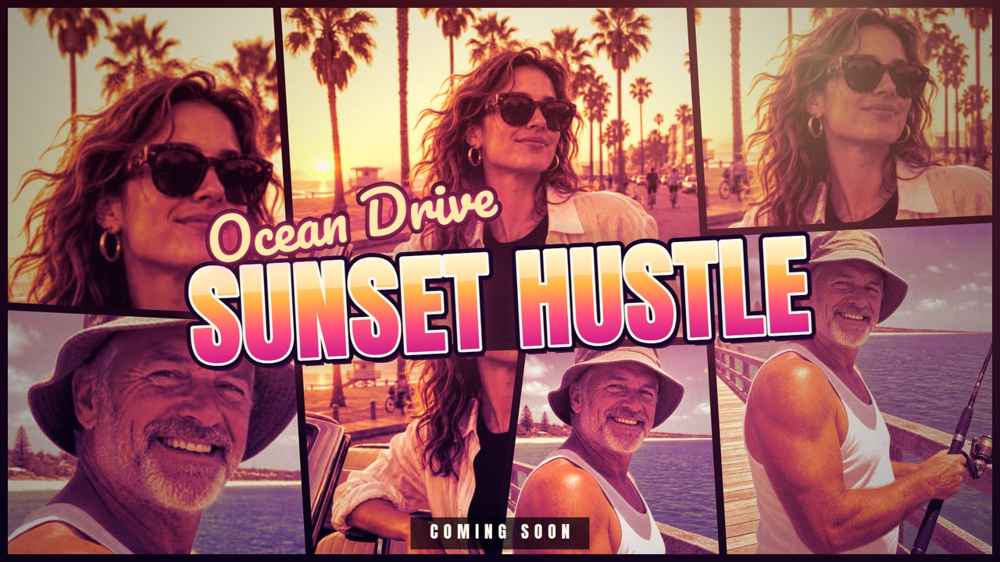

# Sunset Grid · cover studio

[](https://make.fun/bounty/gta6-cover-art-01)
[](https://make.fun/bounty/gta6-cover-art-01)
[](https://make.fun/bounty/gta6-cover-art-01)



Sunset Grid turns your own photos and a caption into multi-panel, open-world-crime-poster cover art and exports
it as a PNG. Its design is its own: slanted panel grids, a dusk or neon colour grade, and a stacked title. It
runs offline in desktop Chrome from plain static files under `app/`. There is no build step, no library and no
network request, and your photos never leave your computer.

**Two clicks:** add a photo, then press **Export PNG**. One photo fills every panel at once: the app finds the
face in it and frames a wide hero shot, close-ups and details around it. Type a title and it is lettered for you.

## What it does

- **Your photos:** pick them or drop them in (JPEG, PNG or WebP). Use one photo across the grid, or several that
  share it. Choose which photo goes in each panel.
- **Crop and position:** click a panel, drag to pan, scroll or use the slider to zoom, and double-click to reset.
  *Use in every panel* and *Auto-arrange* refill the grid in one step.
- **7 panel layouts:** Mosaic, Hero 3, Grid 4, Triptych, Strip, Slash and Solo. They have slanted gutters and are
  re-cut for portrait covers. You can set the gutter width and a dark or white frame.
- **3 grades:** Vice Sunset (magenta dusk with a low orange sun), Neon Night (violet shadows with pink and cyan
  neon tubes along the gutters) and VHS Tape (faded colour, colour bleed, scanlines, a tracking glitch and a
  deck display). Each has a strength slider.
- **Lettering:** the title is stacked in Anton, with each line scaled to a shared width and extruded,
  double-outlined and gradient-filled (Sunset, Neon, Chrome or Bold white). A glowing Pacifico script tagline
  sits over it and a spaced-out footer runs along the bottom. Size, tilt and position are adjustable.
- **Export:** 1920 × 1080, 1080 × 1080 and 1080 × 1350, one at a time or all three. The live preview and the
  PNG are drawn by the same `renderCover`, so what you see is what you get.

## Run it

```sh
node serve.ts                      # serves app/ on http://localhost:8080
node tools/smoke.mjs               # drives the editor in headless Chrome: upload, drag, zoom, export all sizes
node tools/shoot.mjs               # renders screenshots/ from shots.json (exported PNGs, scaled down)
mkdir -p out && MAKEFUN_OUTPUT_DIR=out node main.ts
```

## Credits

- Fonts: [Anton](app/fonts/anton/OFL.txt) and [Pacifico](app/fonts/pacifico/OFL.txt), under the SIL Open Font
  License 1.1.
- Sample photos (`app/samples/`) were made with an image model for make.fun and are free to use.
- Not affiliated with or endorsed by Rockstar Games. The app uses no Rockstar logo, artwork, character or font.

License: see [LICENSE](LICENSE).
